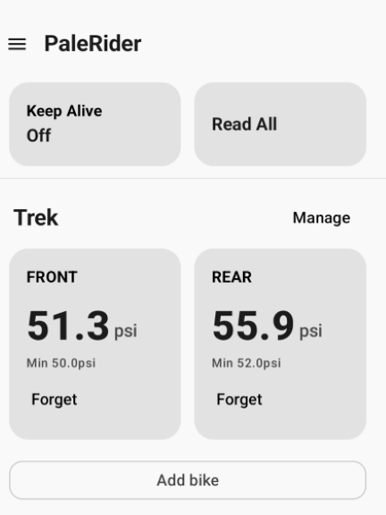
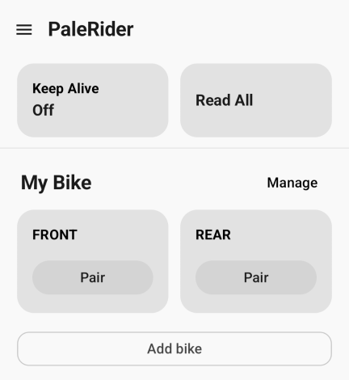
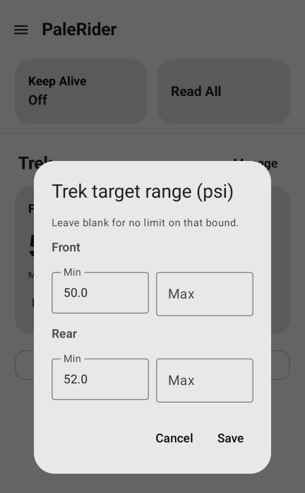
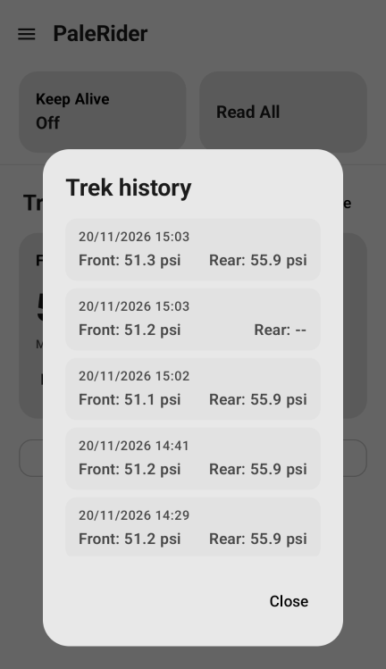
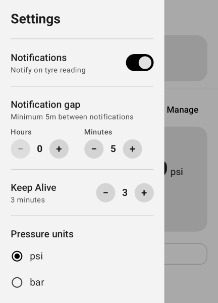

# PaleRider
An alternative companion app for Outrider TL Mini tyre pressure sensor.

## Overview

The official Outrider app didn't quite do what I wanted, so I built PaleRider, a companion app to fit my needs.  This does not replace the official app - you must still use that for things like updating firmware so make sure you have set everything up in there before using this.  Also this app does not support the 'Bridge mode' offered by the official app - it will only work with direct BLE connection from your sensors to the GPS.

Once set up, PaleRider will send you a notification when your tyre sensors wake, and will let you know if your tyre pressures are within your "ready to ride" range or not.  It then gets out of the way leaving your sensors free to connect to your GPS.  It operates using an Android OS level background BLE scan so the app is battery efficient and is not continually awake looking for Outrider sensors.

At release this has only been tested on a small number of sensors.  It is possible that other Outrider sensors will present differently so if you run into problems please raise an issue so I can investigate further.

If you find PaleRider useful a coffee is always appreciated!

## Building the Android App

The easiest way to get this is to install the APK from the [latest release](https://github.com/Nilogax/PaleRider/releases) onto your phone (the APK is in the `Assets` section of each release).  To do this you will need to enable your phone's option to load APKs that aren't from Google Play - check the details of this for your specific phone model and Android version.

Alternatively you can build it from the source code using Android Studio:

1. Download and install Android Studio from https://developer.android.com/studio  This may take some time.

1. In Android Studio use `File/Open` to a select the `/Android App` folder in your cloned repository.  Android Studio will now scan the project folder and download all the resources needed.  This may take some time.  If Android Studio asks about updating/upgrading components then the safest option for an unfamiliar user is usually 'No'.

1. Enable Developer Options on your phone, this is usually done by navigating to `Settings/About phone` and tapping the `Build number` repeatedly.

1. Connect your phone to Android Studio.  This is usually done via WiFi - search for `Wireless debugging` in your phone's settings and enable this option, then choose `Pair device with pairing code`.  In Android Studio go to `Tools/Device Manager`, click the `Pair devices using WiFi` option, select `Pair using pairing code`.  After a short wait your phone should be listed on the screen as `Device at xyz.xyz.xyz.xyz`, click `Pair` then enter the code that's shown on your phone screen.

1. Build and install the PaleRider app.  In Android Studio choose `Run/Run app`.  Android Studio will then build the app, install it on your phone and activate it.

## Usage

The app requires Bluetooth permission (`Find...nearby devices`) to connect to the Outrider sensors and Notification permission to allow it to send notifications when pressure is read.  These will be requested when first needed.

You will be presented with an initial bike, "My Bike" with no paired sensors as shown above.  Make sure the official Outrider app is not running (swipe it away if it is), wake the sensors on your bike then tap the `Pair` button for the Front wheel.  Select the appropriate `OutriderF` sensor and the app will pair with it and shortly display a reading.  Repeat for the rear wheel.  A sensor will show an alert if it has already been paired with a bike in PaleRider.  If you make an error you can tap the `Forget` button for any paired wheel and that sensor will be released.

You can then either tap `Add Bike` to create another bike to pair with new sensors, or use the `Manage` option for the bike to set a target pressure range, see the pressure reading history, rename the bike or delete it.

The target pressure range allows you to define maximum and/or minimum pressures that you're happy to start a ride with.  If you don't define a particular value then the app does not check for that bound, so in the example above there is only a minimum pressure set for each wheel.

If the pressure readings are inside the target window the app will notify you with a confirmation sound and the notification will show the pressures.  If any value is outside the target range the app notification will have a different (warning) sound and the notification will show a HIGH or LOW indication for that wheel.  Also the app will show a high or low pressure by changing the background colour for each affected wheel.

The history view shows a log of the last 30 pressure readings for that bike, so you can track if you have a slow puncture or other issue.

There are two buttons at the top of the main screen - `Keep Alive` and `Read All`.  `Keep Alive` will keep the connection to all known and available sensors open so that you can use it to adjust tyre pressures.  The duration that the connections are kept open is defined in the `Settings` menu.  After that timer expires the connections are released.  The `Read All` button will attempt to get a pressure reading from all known and available sensors.

A wheel sensor will show a `LIVE` indicator at the top right of its window when it is connected to PaleRider.  If you try `Keep Alive` or `Read All` and do not see that `LIVE` indicator for a sensor it is likely that it is not awake.  Shaking or spinning the wheel should wake it up and allow it to connect.

Tap the 3 bar menu icon at the top of the main screen to open the `Settings` window.  This allows you to customise some aspects of PaleRider.

If you don't want the app to send notifications for any reason then you can toggle the `Notifications` slider to the left to turn it off.  It is on by default.

You can configure the minimum interval between PaleRider notifications for full readings (ie all sensors connected to a bike) by adjusting the `Notification gap`.  Setting it to 0 hours, 0 minutes will notify you each time the sensors are detected by the phone. That means you could for example get a notification when you wheel the bike out of the garage, head back indoors (out of BLE range) to grab your bottle and helmet, then get another notification when you approach the bike and the sensors connect again.  This is set to 30 minutes by default but it's worth setting it higher if, for example, you routinely carry your bike in/on a vehicle to get to your rides.  Maximum allowed value is 23h 59m, so one notification a day.

If only one wheel is read then you will still receive a notification when the other wheel is read, regardless of the `Notification gap` setting.

The `Keep Alive` setting allows you to configure how long sensor connections are held open when you tap the `Keep Alive` button on the main screen.

Finally the `Pressure units` option allows you to select psi or bar - all stored values will be converted to the new unit.

## Release History

Distributed under the GPL-2.0 license. See ``LICENSE`` for more information.
